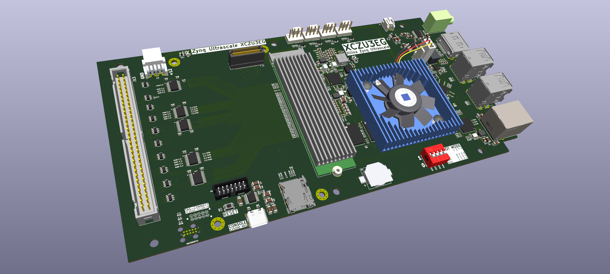
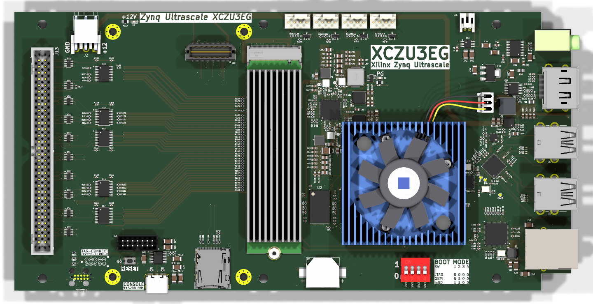

# UltrascaleSBC

KiCad files for a Zynq UltraScale+ (XCZU3EG) single-board computer.

Write-up: [https://bbenchoff.com/pages/UltrascaleSBC.html](https://bbenchoff.com/pages/UltrascaleSBC.html)

- `Controller.kicad_pro` — KiCad 10 project (schematic, PCB, libraries in `parts/`, 3D models in `3D/`)
- `production/` — Gerbers, BOM, and placement files as ordered from JLCPCB
